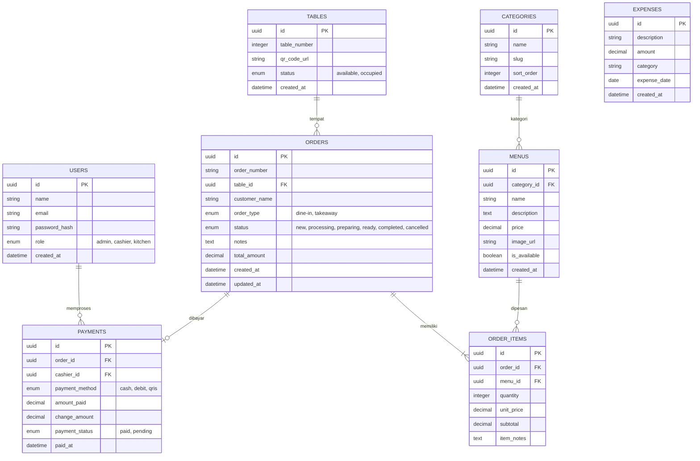

# Perancangan Database & Diagram ERD (PostgreSQL / Supabase)
## Tahap 2 Metode Waterfall: Perancangan Sistem (System & Database Design)

**Judul Tugas Akhir**: Rancang Bangun Sistem Pemesanan Menu, Monitoring Pesanan, dan Laporan Penjualan pada Saung Pete Cina Berbasis Web Menggunakan QR Code dengan Metode Waterfall  

---

## 1. Entity Relationship Diagram (ERD)



---

## 2. Struktur Skema Tabel PostgreSQL DDL (SQL Script)

```sql
-- Enums
CREATE TYPE user_role AS ENUM ('admin', 'cashier', 'kitchen');
CREATE TYPE table_status AS ENUM ('available', 'occupied');
CREATE TYPE order_type AS ENUM ('dine-in', 'takeaway');
CREATE TYPE order_status AS ENUM ('new', 'processing', 'preparing', 'ready', 'completed', 'cancelled');
CREATE TYPE payment_method AS ENUM ('cash', 'debit', 'qris');
CREATE TYPE payment_status AS ENUM ('paid', 'pending');

-- 1. Tabel Users (Admin, Kasir, Dapur)
CREATE TABLE users (
    id UUID PRIMARY KEY DEFAULT gen_random_uuid(),
    name VARCHAR(100) NOT NULL,
    email VARCHAR(100) UNIQUE NOT NULL,
    password_hash TEXT NOT NULL,
    role user_role NOT NULL DEFAULT 'cashier',
    created_at TIMESTAMP WITH TIME ZONE DEFAULT CURRENT_TIMESTAMP
);

-- 2. Tabel Tables (Nomor Meja & QR Code)
CREATE TABLE tables (
    id UUID PRIMARY KEY DEFAULT gen_random_uuid(),
    table_number INT UNIQUE NOT NULL,
    qr_code_url TEXT,
    status table_status DEFAULT 'available',
    created_at TIMESTAMP WITH TIME ZONE DEFAULT CURRENT_TIMESTAMP
);

-- 3. Tabel Categories (Kategori Menu)
CREATE TABLE categories (
    id UUID PRIMARY KEY DEFAULT gen_random_uuid(),
    name VARCHAR(50) NOT NULL,
    slug VARCHAR(50) UNIQUE NOT NULL,
    sort_order INT DEFAULT 0,
    created_at TIMESTAMP WITH TIME ZONE DEFAULT CURRENT_TIMESTAMP
);

-- 4. Tabel Menus (Katalog Makanan & Minuman)
CREATE TABLE menus (
    id UUID PRIMARY KEY DEFAULT gen_random_uuid(),
    category_id UUID REFERENCES categories(id) ON DELETE SET NULL,
    name VARCHAR(100) NOT NULL,
    description TEXT,
    price DECIMAL(12, 2) NOT NULL,
    image_url TEXT,
    is_available BOOLEAN DEFAULT TRUE,
    created_at TIMESTAMP WITH TIME ZONE DEFAULT CURRENT_TIMESTAMP
);

-- 5. Tabel Orders (Pesanan Pelanggan)
CREATE TABLE orders (
    id UUID PRIMARY KEY DEFAULT gen_random_uuid(),
    order_number VARCHAR(20) UNIQUE NOT NULL,
    table_id UUID REFERENCES tables(id) ON DELETE SET NULL,
    customer_name VARCHAR(50) DEFAULT 'Pelanggan',
    order_type order_type DEFAULT 'dine-in',
    status order_status DEFAULT 'new',
    notes TEXT,
    total_amount DECIMAL(12, 2) NOT NULL DEFAULT 0,
    created_at TIMESTAMP WITH TIME ZONE DEFAULT CURRENT_TIMESTAMP,
    updated_at TIMESTAMP WITH TIME ZONE DEFAULT CURRENT_TIMESTAMP
);

-- 6. Tabel Order Items (Detail Rincian Item Pesanan)
CREATE TABLE order_items (
    id UUID PRIMARY KEY DEFAULT gen_random_uuid(),
    order_id UUID REFERENCES orders(id) ON DELETE CASCADE,
    menu_id UUID REFERENCES menus(id) ON DELETE RESTRICT,
    quantity INT NOT NULL CHECK (quantity > 0),
    unit_price DECIMAL(12, 2) NOT NULL,
    subtotal DECIMAL(12, 2) NOT NULL,
    item_notes TEXT
);

-- 7. Tabel Payments (Pembayaran Kasir)
CREATE TABLE payments (
    id UUID PRIMARY KEY DEFAULT gen_random_uuid(),
    order_id UUID UNIQUE REFERENCES orders(id) ON DELETE CASCADE,
    cashier_id UUID REFERENCES users(id) ON DELETE SET NULL,
    payment_method payment_method NOT NULL,
    amount_paid DECIMAL(12, 2) NOT NULL,
    change_amount DECIMAL(12, 2) DEFAULT 0,
    payment_status payment_status DEFAULT 'paid',
    paid_at TIMESTAMP WITH TIME ZONE DEFAULT CURRENT_TIMESTAMP
);

-- 8. Tabel Expenses (Pengeluaran Operasional Rumah Makan)
CREATE TABLE expenses (
    id UUID PRIMARY KEY DEFAULT gen_random_uuid(),
    description TEXT NOT NULL,
    amount DECIMAL(12, 2) NOT NULL,
    category VARCHAR(50) DEFAULT 'Operasional',
    expense_date DATE DEFAULT CURRENT_DATE,
    created_at TIMESTAMP WITH TIME ZONE DEFAULT CURRENT_TIMESTAMP
);
```

---
*Skema database ini dirancang untuk kompatibel 100% dengan Supabase PostgreSQL serta mendukung fitur Supabase Realtime Subscriptions pada tabel `orders`.*

> Versi yang dijalankan sesungguhnya (lengkap dengan indeks, trigger, penomoran pesanan, dan RLS) ada di `supabase/migrations/` dan `database/schema_db_saoengpetecina.sql`. Dokumentasi rincian 7 kategori, 57 daftar menu asli Saung Pete Cina, sinkronisasi Backend & Frontend, serta pembaruan URL gambar menu tersedia di `docs/sinkronisasi-database-backend-frontend.md` dan `docs/update-gambar-menu-database.md`.
